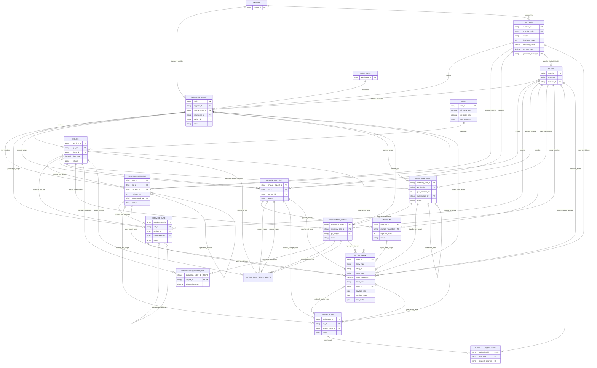

# Relational schema and event-history model

## Scope and design principles

This document specifies the SQLite persistence contract for the supplier acknowledgement workflow. The ten business entities are **Supplier**, **PurchaseOrder**, **POLine**, **Acknowledgement**, **PromiseDate**, **ChangeRequest**, **Approval**, **InventoryPlan**, **ProductionOrder**, and **Notification**. The database also contains normalized master/support tables (`actors`, `items`, `warehouses`, `carriers`), the `entity_event` audit log, and the `notification_recipient` and `production_order_line` bridges, plus the append-only `production_order_impact` ledger table.

- Every core entity has its own primary key and declared foreign keys. Relationship ownership joins are protected by composite foreign keys or consistency triggers where a single-column FK would allow a parent mismatch.
- SQLite foreign-key enforcement is switched on by `create_all()` and verified before it returns. A caller opening an existing connection should still use `PRAGMA foreign_keys = ON` on every connection.
- Business status enums are constrained in DDL. The transition graph is checked by the workflow layer (`is_legal_transition`) so a rejected transition can be logged as an anomaly without mutating the valid current row.
- Acknowledgement revision payloads, InventoryPlan versions, Approval rows, ProductionOrderImpact rows, and the event log are append-only. A new response or projection requires a new row; a terminal approval decision cannot be rewritten. ProductionOrder has a current-state snapshot, while each impact/status transition is preserved in the event log.
- The event log is append-only. Insert/update triggers create full `previous_state` / `new_state` snapshots; direct event-log UPDATE and DELETE operations are rejected.
- The status columns on the core tables are query-friendly current-state snapshots. The event history is the durable audit source; a historical state can be reconstructed by replaying ordered events. Business payload fields on revision entities are not overwritten to represent a later revision.

## ER diagram

The diagram shows FK cardinalities. The edges from each entity to `ENTITY_EVENT` are true relationships backed by typed FK target columns in `entity_event`; `entity_type` / `entity_id` are the public polymorphic discriminator pair.



## Relationship/cardinality register

`1:N` means one parent can have zero or many child rows, with each child pointing to exactly one parent. `N:M` is implemented only through a bridge table. Optional child links are shown explicitly.

| Parent | Child / bridge | Cardinality | FK / join contract | Optionality and notes |
|---|---|---|---|---|
| Supplier | PurchaseOrder | 1:N | `purchase_orders.supplier_id → suppliers.supplier_id`; composite `(po_id,supplier_id)` is also referenced by acknowledgement/change-request rows | A PO always has a supplier; a supplier may have no POs. |
| Supplier | Acknowledgement | 1:N | `acknowledgements.supplier_id → suppliers.supplier_id` plus composite `(po_id,supplier_id)` to the PO | Every acknowledgement belongs to the PO’s supplier. |
| Supplier | ChangeRequest | 1:N | `change_requests.supplier_id → suppliers.supplier_id` plus composite `(po_id,supplier_id)` to the PO | Every change request belongs to the PO’s supplier. |
| Supplier | Actor (supplier identity) | 1:1 (optional) | `actors.supplier_id → suppliers.supplier_id` | Only the supplier-role actor has `supplier_id`; its `actor_id` must equal the Supplier key. |
| Actor | PurchaseOrder | 1:N | `planner_actor_id` and `created_by_actor_id` → `actors.actor_id` | Role triggers require planner actor role for planner ownership and require creator role to match `created_by_role`. |
| Actor | Acknowledgement | 1:N | `created_by_actor_id → actors.actor_id` | Role/id pairing is checked when the event trigger writes the event. |
| Actor | PromiseDate | 1:N | `created_by_actor_id → actors.actor_id` | Role/id pairing is checked through the event log composite FK. |
| Actor | ChangeRequest | 1:N | `requested_by_actor_id → actors.actor_id` | Requested role and actor role must match. |
| Actor | Approval | 1:N | `approver_actor_id → actors.actor_id` | Approver role is limited to `planner` or `operations_manager`; actor role must match. |
| Actor | InventoryPlan | 1:N | `planner_actor_id`, optional `approved_by_actor_id` → `actors.actor_id` | Planner must be a planner; approval actor, if supplied, must be planner or operations manager. |
| Actor | ProductionOrder | 1:N | `owner_actor_id → actors.actor_id` | Actor role must match `owner_role`. |
| Warehouse | PurchaseOrder | 1:N | `purchase_orders.warehouse_id → warehouses.warehouse_id` | Every PO has one destination warehouse; a warehouse may serve many POs. |
| Carrier | PurchaseOrder | 1:N | `purchase_orders.carrier_id → carriers.carrier_id` | Every PO has a nominated carrier; a carrier may service many POs. |
| Carrier | Supplier (preferred carrier) | 1:N | `suppliers.preferred_carrier_id → carriers.carrier_id` | Each generated supplier references one preferred carrier; one carrier can be preferred by many suppliers. The FK is enforced in SQLite. |
| Item | POLine | 1:N | `po_lines.item_id → items.item_id` | Every PO line references one master item. The item master stores `unit_price_min`, `unit_price_max`, and `price_currency`; generated line prices must be inside the item-specific band. |
| PurchaseOrder | POLine | 1:N | `po_lines.po_id → purchase_orders.po_id` | A draft PO may temporarily have zero lines; issued POs should be validated by workflow before release. |
| PurchaseOrder | Acknowledgement | 1:N | `acknowledgements.po_id → purchase_orders.po_id` | Each revision is a separate row; partial unique indexes permit one header revision per PO/revision and one line revision per PO-line/revision. |
| POLine | Acknowledgement | 1:N | Optional `acknowledgements.po_line_id` plus composite `(po_id,po_line_id)` FK | Header acknowledgements have `po_line_id = NULL`; line-scoped acknowledgement revisions point to a line from that PO. |
| Acknowledgement | PromiseDate | 1:N | Composite `(ack_id,po_id,po_line_id)` FK to acknowledgement identity/scope | A PromiseDate requires a line-scoped acknowledgement and records one line promise revision. A header acknowledgement may have no PromiseDate child. |
| PurchaseOrder | PromiseDate | 1:N | `promise_dates.po_id → purchase_orders.po_id` plus composite joins | The PO key in PromiseDate must match the referenced acknowledgement and line. |
| POLine | PromiseDate | 1:N | `promise_dates.po_line_id → po_lines.po_line_id` plus composite `(po_id,po_line_id)` FK | A line may receive many promise revisions; each promise row belongs to one line. |
| PurchaseOrder | ChangeRequest | 1:N | `change_requests.po_id → purchase_orders.po_id` | Change requests are PO-specific. |
| POLine | ChangeRequest | 1:N optional | Optional `change_requests.po_line_id` and composite `(po_id,po_line_id)` FK | NULL means PO-wide; populated means line-scoped. |
| ChangeRequest | Approval | 1:N optional | `approvals.change_request_id → change_requests.change_request_id` | Zero approvals is valid while pending; separate `approval_round` values represent multi-level decision history. |
| PurchaseOrder | InventoryPlan | 1:N | `inventory_plans.po_id → purchase_orders.po_id` | Retained for query scope; composite PO-line FK ensures it matches the line. |
| POLine | InventoryPlan | 1:N | `inventory_plans.po_line_id → po_lines.po_line_id` and `(po_id,po_line_id)` composite FK | Each projection revision is a new row; no plan is required for every line. |
| InventoryPlan | ProductionOrder | 1:N optional | Composite `(inventory_plan_id,po_id,po_line_id)` FK | A production order must point to a matching plan snapshot; a plan can have no downstream production order. |
| POLine | ProductionOrder (primary impact) | 1:N optional | `production_orders.po_line_id → po_lines.po_line_id` with matching `(po_id,po_line_id)` composite FK | Records the one primary PO line whose delay triggered the schedule impact. A line may have no production order. |
| ProductionOrder | ProductionOrderLine | 1:N | `production_order_line.production_order_id → production_orders.production_order_id` | Each allocation bridge row allocates one PO line to an order. |
| POLine | ProductionOrderLine | 1:N | `production_order_line.po_line_id → po_lines.po_line_id` | A PO line may supply multiple production orders. |
| ProductionOrder ↔ POLine | `production_order_line` | N:M | Composite PK `(production_order_id,po_line_id)`, both columns FKs; `allocated_quantity` records the allocation | Represents component consumption and can include PO lines beyond the order’s primary impacted line. No direct N:M join is used. |
| Notification | NotificationRecipient | 1:N optional | `notification_recipient.notification_id → notifications.notification_id` | A notification can target multiple roles; duplicate role fan-out for the same notification is blocked by the composite PK. |
| Actor | NotificationRecipient | 1:N optional | Composite `(recipient_actor_id,actor_role) → actors(actor_id,actor_role)` | Role-only recipients may leave `recipient_actor_id` NULL; a named recipient must have the same role. |
| PurchaseOrder | Notification | 1:N optional | Optional `notifications.po_id → purchase_orders.po_id` | `po_id = NULL` is allowed only for system-wide notices with no acknowledgement/change link. |
| Acknowledgement | Notification | 1:N optional | Optional `notifications.ack_id → acknowledgements.ack_id` plus `(ack_id,po_id)` composite FK | Link absent for unrelated notices. If set, the PO must match. |
| ChangeRequest | Notification | 1:N optional | Optional `notifications.change_request_id → change_requests.change_request_id` plus `(change_request_id,po_id)` composite FK | A notification may have no linked change request. If set, the PO must match. |
| EntityEvent | Notification | 1:N optional | `notifications.source_event_id → entity_event.event_id` | One source event may trigger many notifications; a direct/system-wide notification may have no source event. |
| Each of the 10 core entities | EntityEvent | 1:N | Exactly one typed `target_*_id` FK is non-NULL; `entity_type` and `entity_id` must agree with that FK | Supports event history polymorphism without sacrificing referential integrity. `entity_id` alone is not a cross-table FK; the typed target FK plus CHECK enforces its target. |
| Acknowledgement | Acknowledgement (supersession) | 1:N self-reference | Optional `superseded_by → acknowledgements.ack_id` | A revision can point forward to its successor. Revision payload cannot be edited; only lifecycle/supersession metadata can change. |
| PromiseDate | PromiseDate (supersession) | 1:N self-reference | Optional `superseded_by → promise_dates.promise_date_id` | Every promise update is another version; old records are retained. |
| InventoryPlan | InventoryPlan (supersession) | 1:N self-reference | Optional `superseded_by → inventory_plans.inventory_plan_id` and `previous_version_id → inventory_plans.inventory_plan_id` | Each projection is a new immutable version; UPDATE and DELETE are prohibited. |
| Actor | EntityEvent | 1:N optional | Composite `(actor_id,actor_role) → actors(actor_id,actor_role)` | `actor_id` is NULL for system-attributed events; non-NULL actor ID and role must match. |

## Optional relationships and deletion policy

- A `ChangeRequest` can exist in `DRAFT`, `SUBMITTED`, or `UNDER_REVIEW` without any `Approval` rows. A request entering a threshold-governed decision path should create approval rounds as required by the workflow rules.
- A `Notification` may have no `change_request_id`. A system-wide notice has `po_id`, `ack_id`, and `change_request_id` all NULL; it may still have a `source_event_id` or no source event.
- A `ProductionOrder` is not mandatory for a PO line. When created, its primary `po_line_id` and `inventory_plan_id` are required and must agree with the plan’s PO and line.
- `Acknowledgement.po_line_id` is NULL for a PO-header response. A `PromiseDate` is line-level and therefore requires an acknowledgement revision scoped to that same PO line.
- All operational foreign keys use `ON DELETE RESTRICT`; parent records are not cascade-deleted out from under the audit trail. `ON UPDATE CASCADE` is present for relationally referenced keys, but primary/business IDs should be treated as immutable because event history is append-only.

## Tables: current snapshots, immutable revisions, and event history

| Table | Data behavior | Update policy | Why history is preserved |
|---|---|---|---|
| `suppliers`, `purchase_orders`, `po_lines`, `change_requests`, `production_orders`, `notifications` | Current-state snapshot plus captured changes | Normal mutable fields may be updated; every INSERT and changed-row UPDATE emits an event | `entity_event` stores previous and new full-row JSON snapshots. |
| `acknowledgements` | One row per supplier response revision | Business payload fields are immutable; a new revision is inserted for changed quantities, value, notes, response time, or promise payload. Status and `superseded_by` may change and are logged. | Partial unique indexes scope revisions to header PO or specific PO line. Supersession never deletes the old revision. |
| `promise_dates` | One row per promise revision for one acknowledged line | Append another row for a changed date; the existing row and payload remain available. | `sequence_no`, `revision_no`, `prior_promised_date`, `superseded_by`, and events retain the chronology. |
| `inventory_plans` | One row per projected-supply version | Projection inputs/results are immutable; a new `plan_revision_no` is required for a recalculation. Status and supersession metadata may change. | Each plan version is independently queryable and event snapshots capture status changes. |
| `approvals` | One append-only row per approval decision/round | Approval rows cannot be updated or deleted. Pending rows remain pending; a later decision or appeal is represented by a new row with a new approval round. `comments` captures the human-readable explanation and is immutable with the row. | The event log retains approval decisions, escalation routing, approver, decision timestamp, and reason. |
| `notification_recipient`, `production_order_line` | Relational bridges | Bridge changes are explicit; deleting referenced parents is restricted | Allocation and delivery targeting are represented as rows rather than comma-separated lists. |
| `entity_event` | Append-only system event history | UPDATE and DELETE are blocked by triggers; inserts are produced automatically by table triggers or by the workflow for rejected attempts/anomalies | Each row contains `event_id`, `entity_type`, `entity_id`, `event_type`, `event_timestamp`, `actor_role`, `payload_json`, `previous_state`, `new_state`, optional anomaly labels, and a typed target FK. |

### Event row structure and emission rules

`entity_event` contains all requested fields plus:

- `actor_id`: nullable FK to `actors`, with composite role agreement when populated.
- `issue_type`, `ground_truth`: optional paired anomaly labels so failed attempts can be audited without mutating the target row.
- One nullable typed target FK per supported core entity (`target_supplier_id`, `target_po_id`, `target_po_line_id`, `target_ack_id`, `target_promise_date_id`, `target_change_request_id`, `target_approval_id`, `target_inventory_plan_id`, `target_production_order_id`, `target_notification_id`). A CHECK requires exactly one target FK and verifies it equals `entity_id` for `entity_type`.

Automatic triggers write an event for each core-row INSERT and each UPDATE that changes one or more fields. Insert event names include `PO_CREATED`, `ACKNOWLEDGEMENT_RECEIVED`, `ACK_ACCEPTED`, `ACK_REJECTED`, `CHANGE_REQUESTED`, `CHANGE_APPROVED`, `CHANGE_REJECTED`, `PLAN_CREATED`, `PLAN_UPDATED`, and `NOTIFICATION_SENT` as appropriate to the row’s state. Updates with other data changes still emit entity-specific update events. The workflow must validate a candidate status transition with `is_legal_transition()` before updating the snapshot; when it rejects an attempted transition, it writes a labelled `INVALID_TRANSITION` event with the requested next state in `payload_json`, leaving the current entity row unchanged.

Use an ISO-8601 UTC timestamp (`YYYY-MM-DDTHH:MM:SS.sssZ`) for event time. An entity’s event sequence is read in insertion order (`ORDER BY rowid`) or timestamp/insertion order; the full snapshots allow a consumer to rebuild the current record and evaluate the path that led to it.

## Lifecycle state machines

The state and edge maps are the same maps exported by `STATUS_ENUMS` and `STATUS_TRANSITIONS` in `schema.py`. The DDL restricts values to the enum; the workflow applies legal-transition checks before a state update so an invalid attempt can itself be written as a traceable event instead of silently corrupting the current snapshot.


### PurchaseOrder

| Current state | Next state | Business rule / trigger |
|---|---|---|
| `DRAFT` | `ISSUED` | Planner releases a complete header after supplier, destination, carrier, dates, currency and line totals validate. |
| `DRAFT` | `CANCELLED` | Authorized requester cancels a draft before release. |
| `ISSUED` | `PARTIALLY_ACKNOWLEDGED` | A supplier response resolves at least one line/quantity but not all ordered quantities. |
| `ISSUED` | `ACKNOWLEDGED` | All required PO lines have final accepted/rejected quantities that reconcile to requested quantities. |
| `ISSUED` | `CHANGE_PENDING` | A submitted change request requires a threshold review or approval. |
| `ISSUED` | `IN_FULFILLMENT` | Supplier commitments are accepted and warehouse/carrier hand-off is initiated. |
| `ISSUED` | `CANCELLED` | An authorized cancellation is accepted before fulfillment has begun. |
| `ISSUED` | `CLOSED` | The PO is explicitly closed under an approved no-fulfillment/administrative disposition. |
| `PARTIALLY_ACKNOWLEDGED` | `ACKNOWLEDGED` | Remaining PO lines receive final responses and all quantity splits reconcile. |
| `PARTIALLY_ACKNOWLEDGED` | `CHANGE_PENDING` | A new supplier change introduces an approval/review exception. |
| `PARTIALLY_ACKNOWLEDGED` | `IN_FULFILLMENT` | Planner allows confirmed portions to proceed to fulfillment. |
| `PARTIALLY_ACKNOWLEDGED` | `CANCELLED` | Remaining unfulfilled balance is cancelled by an authorized owner. |
| `ACKNOWLEDGED` | `CHANGE_PENDING` | A later supplier change crosses a price, date-slip, quantity, or cancellation threshold. |
| `ACKNOWLEDGED` | `IN_FULFILLMENT` | Accepted commitments are cleared for shipment/receipt processing. |
| `ACKNOWLEDGED` | `CANCELLED` | Authorized cancellation is approved before physical fulfillment. |
| `CHANGE_PENDING` | `ISSUED` | Change is withdrawn/rejected or resolved without a material PO-line state change; prior issued state is restored. |
| `CHANGE_PENDING` | `PARTIALLY_ACKNOWLEDGED` | Approved change is applied and the remaining supplier response is incomplete. |
| `CHANGE_PENDING` | `ACKNOWLEDGED` | Approved change is applied and all required lines remain fully reconciled. |
| `CHANGE_PENDING` | `CANCELLED` | An approved cancel-PO/line decision cancels the remaining scope. |
| `IN_FULFILLMENT` | `PARTIALLY_RECEIVED` | Warehouse receipt confirms a positive but incomplete quantity against the PO. |
| `IN_FULFILLMENT` | `RECEIVED` | Warehouse receipt confirms all quantities required for receipt completion. |
| `IN_FULFILLMENT` | `CLOSED` | Operations closes a fulfillment record after exception reconciliation. |
| `PARTIALLY_RECEIVED` | `RECEIVED` | Subsequent receipts bring the accepted cumulative quantity to the required quantity. |
| `PARTIALLY_RECEIVED` | `CLOSED` | Operations closes the remaining variance under an approved closeout disposition. |
| `RECEIVED` | `CLOSED` | Receipt, invoice/quantity variance and downstream plan reconciliation are complete. |
| `CANCELLED` | — (terminal) | No outgoing transition is legal. Terminal rows remain in history. |
| `CLOSED` | — (terminal) | No outgoing transition is legal. Terminal rows remain in history. |

### Acknowledgement

| Current state | Next state | Business rule / trigger |
|---|---|---|
| `DRAFT` | `SUBMITTED` | Supplier submits a response; response timestamp and supplier identity are recorded. |
| `DRAFT` | `WITHDRAWN` | Supplier withdraws an unsent draft. |
| `SUBMITTED` | `UNDER_REVIEW` | A quantity/price/date threshold, malformed response, or policy exception requires planner review. |
| `SUBMITTED` | `ACCEPTED` | Entire requested quantity is accepted, price/date checks pass, and any required approvals exist. |
| `SUBMITTED` | `PARTIALLY_ACCEPTED` | Accepted plus rejected quantity equals requested quantity and both accepted/rejected portions are positive. |
| `SUBMITTED` | `REJECTED` | Supplier or authorized planner rejects the response with a reason and reconciled quantities. |
| `SUBMITTED` | `SUPERSEDED` | A newer acknowledgement revision is received for the same PO or PO line. |
| `SUBMITTED` | `WITHDRAWN` | Supplier withdraws the submitted response before a final decision. |
| `UNDER_REVIEW` | `ACCEPTED` | Planner/operations review resolves exceptions and confirms all requested quantity is accepted. |
| `UNDER_REVIEW` | `PARTIALLY_ACCEPTED` | Review confirms the split quantities reconcile and partial acceptance is operationally acceptable. |
| `UNDER_REVIEW` | `REJECTED` | Reviewer rejects a response that violates policy or cannot be fulfilled. |
| `UNDER_REVIEW` | `SUPERSEDED` | A newer acknowledgement revision replaces this pending revision. |
| `UNDER_REVIEW` | `WITHDRAWN` | Authorized withdrawal is accepted before finalization. |
| `ACCEPTED` | `SUPERSEDED` | A later revision replaces the committed quantities/date; prior row payload remains immutable. |
| `PARTIALLY_ACCEPTED` | `SUPERSEDED` | A later revision replaces the partial commitment; prior row payload remains immutable. |
| `REJECTED` | `SUPERSEDED` | A corrected/revised response is received; rejected response remains available as history. |
| `SUPERSEDED` | — (terminal) | No outgoing transition is legal. Terminal rows remain in history. |
| `WITHDRAWN` | — (terminal) | No outgoing transition is legal. Terminal rows remain in history. |

### ChangeRequest

| Current state | Next state | Business rule / trigger |
|---|---|---|
| `DRAFT` | `SUBMITTED` | Requester supplies request type, previous/requested values, reason code, effective date and response deadline. |
| `DRAFT` | `WITHDRAWN` | Requester withdraws an unsubmitted change. |
| `SUBMITTED` | `UNDER_REVIEW` | Request crosses a configurable threshold or requires a planner impact calculation. |
| `SUBMITTED` | `APPROVED` | No approval gate applies, or all required approval levels have already granted approval. |
| `SUBMITTED` | `REJECTED` | A policy rule rejects the request or a required approver rejects it. |
| `SUBMITTED` | `CANCELLED` | Authorized requester cancels before implementation. |
| `SUBMITTED` | `WITHDRAWN` | Requester withdraws before a final decision. |
| `UNDER_REVIEW` | `APPROVED` | All required approval rounds are approved and downstream impact has been assessed. |
| `UNDER_REVIEW` | `REJECTED` | A required approver rejects or the requested change fails policy. |
| `UNDER_REVIEW` | `CANCELLED` | Authorized cancellation occurs before application. |
| `UNDER_REVIEW` | `WITHDRAWN` | Requester withdraws before the approval decision is finalized. |
| `APPROVED` | `IMPLEMENTED` | Approved deltas are applied to the PO/POLine and new promise/InventoryPlan versions are generated. |
| `APPROVED` | `CANCELLED` | Operations cancels an approval before implementation; reason is logged. |
| `REJECTED` | `CLOSED` | Rejected decision is communicated and the workflow is closed. |
| `IMPLEMENTED` | `CLOSED` | Plan recalculation and notifications complete; impact metrics are captured. |
| `CANCELLED` | `CLOSED` | Cancellation has been notified and downstream scope is reconciled. |
| `WITHDRAWN` | `CLOSED` | Withdrawal has been recorded and no downstream changes were applied. |
| `CLOSED` | — (terminal) | No outgoing transition is legal. Terminal rows remain in history. |

### InventoryPlan

| Current state | Next state | Business rule / trigger |
|---|---|---|
| `DRAFT` | `PROPOSED` | A complete projection snapshot is calculated and submitted for approval/review. |
| `DRAFT` | `ACTIVE` | Policy determines approval is unnecessary and the snapshot passes consistency checks. |
| `DRAFT` | `CANCELLED` | Draft plan is abandoned before activation. |
| `PROPOSED` | `APPROVED` | Authorized planner/operations manager approves the version and its downstream impact. |
| `PROPOSED` | `REJECTED` | Projection fails policy, data-quality checks or available-supply constraints. |
| `PROPOSED` | `CANCELLED` | Proposed version is withdrawn before approval. |
| `APPROVED` | `ACTIVE` | Approved version becomes the current projected-supply plan on its effective date. |
| `APPROVED` | `SUPERSEDED` | A newer replacement plan is approved/activated before this plan becomes active. |
| `APPROVED` | `CANCELLED` | Approved plan is cancelled before activation with a recorded reason. |
| `REJECTED` | `DRAFT` | The same unchanged snapshot is reopened for reconsideration; changed projection values require a new revision row. |
| `REJECTED` | `CLOSED` | Rejected version is retained and administratively closed. |
| `ACTIVE` | `AT_RISK` | A new event or recalculation indicates a projected shortage, promise slip or schedule-risk threshold breach. |
| `ACTIVE` | `PARTIALLY_FULFILLED` | Receipts or supply confirmations cover only part of the planned quantity. |
| `ACTIVE` | `FULFILLED` | Actual accepted supply meets the demand/receipt target for this plan. |
| `ACTIVE` | `SUPERSEDED` | A newer plan revision replaces the active projection; the old row points to the successor. |
| `ACTIVE` | `CANCELLED` | Remaining plan scope is cancelled by an authorized operator. |
| `AT_RISK` | `ACTIVE` | Risk is cleared without changing the immutable projection values; changed projection values require a new revision. |
| `AT_RISK` | `PARTIALLY_FULFILLED` | Partial actual receipts arrive while residual risk remains. |
| `AT_RISK` | `FULFILLED` | Actual supply ultimately satisfies demand despite the earlier risk state. |
| `AT_RISK` | `SUPERSEDED` | A replacement projection supersedes the risky plan. |
| `AT_RISK` | `CANCELLED` | Authorized cancellation resolves the remaining at-risk scope. |
| `PARTIALLY_FULFILLED` | `FULFILLED` | Subsequent receipts satisfy all remaining quantity. |
| `PARTIALLY_FULFILLED` | `SUPERSEDED` | A new projection version replaces the partially fulfilled snapshot. |
| `FULFILLED` | `CLOSED` | Receipts, residual quantity and schedule impact are reconciled for closeout. |
| `SUPERSEDED` | — (terminal) | No outgoing transition is legal. Terminal rows remain in history. |
| `CANCELLED` | — (terminal) | No outgoing transition is legal. Terminal rows remain in history. |
| `CLOSED` | — (terminal) | No outgoing transition is legal. Terminal rows remain in history. |

## Projected supply and downstream impacts

Every PO line begins with an InventoryPlan baseline at version 1 (`source=po_baseline`), copied from its original requested quantity and required date. A subsequent projection version is generated only after the acknowledgement has been processed and a positive promise exists and all line-scoped change requests are implemented; any pending/rejected change holds the projection at the last approved version. Each subsequent row links to its predecessor through `previous_version_id`. InventoryPlan UPDATE and DELETE operations are rejected by SQLite triggers. Exactly one generated version per line is marked `is_effective=1`.

Production orders are linked to component PO lines through `production_order_line` with `allocated_quantity`. The `production_order_impact` table is an append-only impact ledger keyed to a ProductionOrder, ChangeRequest, and PO line. Date conflicts are computed from the new projected delivery date and `required_by_date`; quantity shortfalls are computed by comparing allocated quantity with projected supply. `compute_impact_severity(slip_days, shortfall_pct)` selects the worse band: date LOW through 2 days, MEDIUM through 7, HIGH through 14, then CRITICAL; quantity LOW through 5%, MEDIUM through 10%, HIGH through 25%, then CRITICAL.

Notifications contain a stable `not_id`, type, severity, subject/body, a related entity pair, send/read state, and recipients in `notification_recipient`. Notifications to planners use `PurchaseOrder.planner_actor_id`, not a random actor. The generator emits an event row for each plan, impact, production-order status change, and notification. `trace(not_id, frames)` walks from notification through a ChangeRequest when one exists, the related acknowledgement when present, the PO, and supplier; supplier silence is explicitly represented as a no-ACK outcome.

## Anomaly handling and integrity policy

An anomaly is never allowed to create a dangling or cross-parent foreign key. Every labelled anomaly row has both `issue_type` and `ground_truth` populated from `ANOMALY_TYPES`; normal rows have both NULL. A DDL constraint may permit a narrowly scoped business-rule anomaly only when its `issue_type` is the matching documented label and `ground_truth` is populated. Enum, primary-key, foreign-key, bridge-key, JSON-shape and typed event-target constraints remain enforced.

| Anomaly class / group | Where it is represented | Deliberate rule exception (if any) | Integrity constraints still satisfied |
|---|---|---|---|
| `LINE_TOTAL_MISMATCH` | `POLine.issue_type`, `POLine.ground_truth` | Only this label pair may bypass `line_total = ROUND(requested_qty × unit_price, 2)`. | All three amounts remain parseable/non-negative unless separately diagnosed; IDs/FKs and one-row identity remain valid. |
| `QUANTITY_MISMATCH`, `OVER_ACKNOWLEDGEMENT` | `Acknowledgement.issue_type`, `ground_truth`; optionally an `InventoryPlan` anomaly | These labels may bypass the final acknowledgement arithmetic check `requested_qty = ack_accepted_qty + ack_rejected_qty`. Inventory projection formulas are bypassed only for an explicitly labelled `QUANTITY_MISMATCH`. | Each referenced PO, supplier, line and actor still exists; numeric fields remain individually typed and non-negative. |
| `DATE_CONFLICT` | Relevant PO, PromiseDate, or schedule row labels | The direct date-order CHECKs on PurchaseOrder, PromiseDate, InventoryPlan and ProductionOrder allow a labelled `DATE_CONFLICT`; the POLine cross-row date trigger allows a pre-order required date only when that line has `issue_type = DATE_CONFLICT` and a populated `ground_truth`. PromiseDate-before-order specifically uses `PROMISE_BEFORE_ORDER`. | All date values still need to be ISO date/datetime in application validation; FK and key integrity remains intact. |
| `PROMISE_BEFORE_ORDER` | `PromiseDate.issue_type`, `ground_truth` | The PromiseDate parent-order-date guard permits a promised date before PO order date only for this label pair. | The PromiseDate still references its exact acknowledgement, PO and PO line through FKs. |
| `STATUS_DATE_MISMATCH` | Relevant acknowledgement, approval, or notification row | The relevant timestamp/status consistency guard allows the labelled row to exist. | Lifecycle enum still valid; all foreign keys and IDs remain valid. |
| `MISSING_ACK`, `MISSING_APPROVAL` | PO or ChangeRequest row labels, or a labelled event | No required-child constraint is bypassed: absence of an ACK or Approval is a valid workflow state and becomes anomalous only when a SLA/step rule says it should exist. | The parent record remains valid; there is no child FK to violate. |
| `PRICE_SPIKE`, `PRICE_MISMATCH`, `DATE_SLIP_REQUIRES_APPROVAL`, `LATE_ACKNOWLEDGEMENT`, `LEAD_TIME_BREACH`, `PROJECTED_SHORTAGE` | Relevant PO line, PromiseDate, ChangeRequest, InventoryPlan or event | These are business-rule exceptions, not key exceptions. `PROJECTED_SHORTAGE` must still satisfy the projection arithmetic; a shortage value itself is not an integrity failure. | Normal FK/unique checks and projection arithmetic remain satisfied. |
| `FOREIGN_KEY_MISMATCH` | `entity_event.issue_type` / `ground_truth` and `payload_json` records the attempted bad target value; optionally an external rejected-input sample | The invalid relationship itself is **not** inserted into the core row, so no FK check is disabled. The event points at an existing entity, and payload captures the attempted nonexistent/wrong-parent ID. | Every persisted FK is valid; the rejected join attempt is traceable without contaminating another row. |
| `DUPLICATE_REVISION` | Label the existing affected row where appropriate and record the rejected candidate in an anomaly event payload | Partial unique indexes still reject duplicate header/line acknowledgement revision numbers; the duplicate candidate is not stored as a second revision row. | PK/unique constraints remain satisfied. |
| `INVALID_TRANSITION` | `entity_event.issue_type`, `ground_truth`, `payload_json` | The invalid target status is recorded as an attempted value in the event, not stored in the current-state table. | Status enum and current row remain valid; event target still has an FK. |
| `NOTIFICATION_FAILURE` | `Notification.issue_type`, `ground_truth`, `status`, `last_error` | Delivery failure is represented as a valid `FAILED`/`BOUNCED` state; only a labelled status/timestamp inconsistency can bypass the delivered timestamp check. | Notification, recipient, source-event and related-PO FKs remain valid. |

Do not disable `PRAGMA foreign_keys`, drop a key constraint, or insert invalid foreign keys to manufacture an anomaly. For invalid relational inputs, record a rejected-attempt event (with a valid existing event target) or store the raw attempted record in the explicitly labelled ground-truth sample outside the relational tables.

## DDL and verification

The source of truth for the database DDL is `create_schema_sql` in `src/supplier_ack/schema.py`. Run:

```python
import sqlite3
from supplier_ack.schema import create_all

conn = create_all("data/generated/supplier_ack.db")
assert conn.execute("PRAGMA foreign_keys").fetchone()[0] == 1
assert conn.execute("PRAGMA foreign_key_check").fetchall() == []
print(conn.execute("SELECT name FROM sqlite_master WHERE type='table' ORDER BY name").fetchall())
conn.close()
```

`create_all()` accepts either a database path or an existing `sqlite3.Connection` and returns the open connection. Schema creation is idempotent for this schema version; `CREATE TABLE IF NOT EXISTS` is not a migration system, so schema changes for an already populated database must be introduced via explicit migrations.

### Derived-value reconciliation gate

`src/supplier_ack/rules/derived.py` is the canonical library for all workflow-derived attributes. After assembling every table, the generator recomputes stored values from source rows and runs `reconcile(dataset)`. Each entity report records `checked_count`, `mismatch_count`, and representative mismatches; generation fails closed if any clean-data mismatch remains. The gate checks line and order arithmetic, accepted/rejected quantity balances, acknowledgement status/deltas, promise slip flags, threshold-required approval level, approved InventoryPlan selection, production risk/shortfall/delay values, supplier scores, notification impact counts, and legal event-log status transitions. Production allocation may exceed current projected supply only for orders whose lifecycle status is `AT_RISK` or `DELAYED`; such shortfall is explicitly derived, not randomized.

## Export artifacts

Generation Step 9 exports the canonical dataset without changing identifiers or business values. CSV table files are placed in `data/generated/csv/`; JSON arrays and a JSON export manifest are placed in `data/generated/json/`; and SQLite `seed.sql` / `seed.db` are placed in `data/generated/sql/`. `data/generated/manifest.json` is the source manifest and contains config, seed/scale, git commit, dependency versions, row counts, and SHA-256 checksums. Ground-truth labels remain in separate ground-truth files and are not exported as entity input columns. The SQL seed declares foreign keys; FK enforcement is disabled only during import so labelled anomalous rows can be preserved and assessed by the ground-truth-aware validator.
