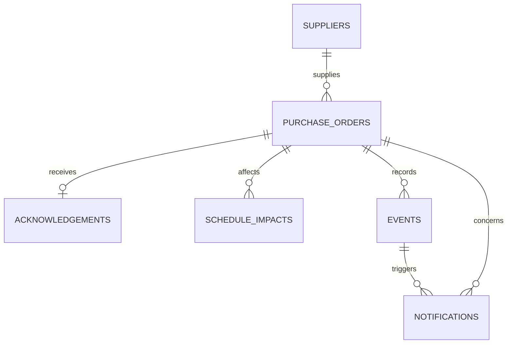

# Schema overview

## ER diagram

## Cardinality

| Parent | Child | Cardinality | Rationale |
|---|---|---:|---|
| Supplier | Purchase order | 1 to many | One supplier can fulfill many POs. |
| Purchase order | Acknowledgement | 1 to 0..1 | A PO may not yet be acknowledged; the initial model keeps the latest acknowledgement state. |
| Purchase order | Schedule impact | 1 to many | Multiple changes may affect downstream plans over time. |
| Purchase order | Event | 1 to many | Every relevant state change is auditable. |
| Event | Notification | 1 to many | A state change can notify multiple operational roles. |
| Purchase order | Notification | 1 to many | A PO can generate multiple notifications. |

Actor roles are persisted as ownership/target/approver fields rather than as an unused reference list.
