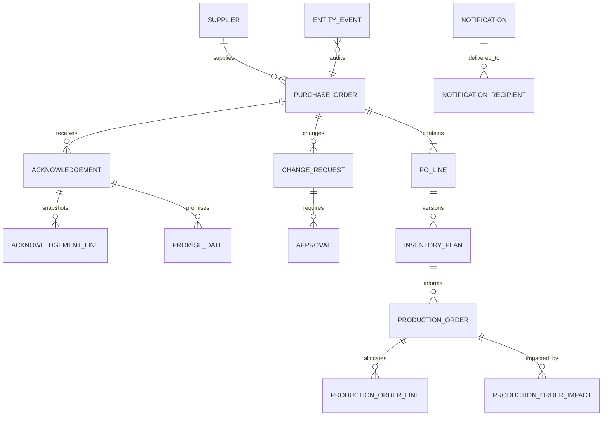

# SQLite schema and event-history contract

The authoritative DDL and field metadata are defined in `src/supplier_ack/schema.py`. This document describes the current implementation; `docs/data_dictionary.md` contains the field-by-field contract generated from the same `ENTITIES` definitions.

## Tables and responsibilities

### Ten core business entities

| Logical entity | SQLite table | Primary key | Purpose |
|---|---|---|---|
| Supplier | `suppliers` | `supplier_id` | Supplier identity, contact, status, reliability and risk metadata. |
| PurchaseOrder | `purchase_orders` | `po_id` | PO header, ownership, dates, currency, and lifecycle state. |
| POLine | `po_lines` | `po_line_id` | Requested quantity/value, item, required date, and line-level current summary. |
| Acknowledgement | `acknowledgements` | `ack_id` | Immutable supplier response revisions and status/quantity summary. |
| PromiseDate | `promise_dates` | `promise_date_id` | Versioned line promise date/quantity and logistics commitments. |
| ChangeRequest | `change_requests` | `change_request_id` | Proposed price, date, or quantity changes and computed threshold metadata. |
| Approval | `approvals` | `approval_id` | Append-only approval/escalation decision rounds. |
| InventoryPlan | `inventory_plans` | `inventory_plan_id` | Baseline and approval-gated supply projection versions. |
| ProductionOrder | `production_orders` | `production_order_id` | Downstream schedule state and projected supply risk. |
| Notification | `notifications` | `notification_id` | Traceable notice metadata, rendered content, and delivery/read status. |

### Supporting/master/bridge tables

| Table | Responsibility / integrity contract |
|---|---|
| `actors` | Actor identities and one of the five configured roles: supplier, planner, carrier/warehouse operator, logistics analyst, operations manager. |
| `items` | Item master and default UOM/price reference. |
| `warehouses` | Warehouse master. |
| `carriers` | Carrier master. |
| `acknowledgement_lines` | Full immutable per-line snapshot for every acknowledgement revision; unique by acknowledgement and PO line. |
| `notification_recipient` | Notification-to-recipient bridge; prevents duplicate recipient links and supports fan-out. |
| `production_order_line` | Production-order-to-PO-line allocation bridge; stores allocated quantity/UOM and audit events. |
| `production_order_impact` | Append-only impact ledger with type, source values, severity, and linked entities. |
| `entity_event` | Append-only typed event log with before/after state snapshots and actor/time attribution. |
| Runtime tables | `runtime_processed_event`, runtime exception, and runtime decision records support idempotency, exception queues, and decision traces for live CLI processing. Their exact DDL is installed by the workflow engine. |

## Relationship and integrity rules

- Every core entity has a primary key and declared foreign keys. Supporting references use `actors`, `items`, `warehouses`, `carriers`, or `entity_event` as appropriate.
- SQLite foreign-key enforcement must be enabled per connection with `PRAGMA foreign_keys = ON`. `create_all()` enables it and verifies it before returning the connection.
- Composite foreign keys and consistency triggers prevent child rows from referencing a valid identifier that belongs to the wrong parent. This includes PO/line ownership, promise-date parent consistency, notification relationship consistency, and actor-role constraints.
- Bridge tables enforce composite uniqueness/primary keys so duplicate relationship rows cannot be inserted.
- Enumerated values are constrained in DDL where appropriate. `is_legal_transition()` and `STATUS_TRANSITIONS` define the allowed lifecycle graph; workflow code logs illegal transitions instead of applying them as valid current state.
- Core status columns are query-friendly current-state snapshots. Revision rows, plan versions, approvals, impacts, and events preserve history; a current pointer does not replace the immutable history.

## Revision and approval semantics

- An acknowledgement revision is a full payload snapshot with a revision-specific `ACK-...` identifier. A later revision supersedes the earlier row; payload overwrite is rejected by triggers.
- `PromiseDate` uses per-acknowledgement revision IDs and CURRENT/SUPERSEDED state. A lower revision cannot replace a newer current revision.
- Each PO line receives baseline InventoryPlan version 1. Later versions point to `previous_version_id`; only a change that passes `can_apply()` and has the required approval may become the effective projection. Plan rows are append-only.
- Approval decisions are append-only. A terminal decision cannot be mutated; an appeal/new decision is represented by a new round.
- The generator deliberately injects a labelled `UNAPPROVED_CHANGE_UPDATES_PLAN` anomaly after baseline validation so validation/detectors can prove that the invariant is checked. It is not normal workflow behavior.

## Event history and audit

`entity_event` includes typed entity foreign-key targets plus the public `entity_type` / `entity_id` discriminator. Insert/update triggers on supported entities capture `previous_state` and `new_state`; direct UPDATE/DELETE against the event log is rejected. Event snapshots retain enough context to inspect what changed and trace the actor. Notification recipient and production allocation bridge mutations also produce audit events.

Generated historical timestamps derive from seeded entity dates and are reproducible. Runtime processing timestamps represent actual execution and therefore are not deterministic across separate live runs.

## Diagram



The diagram is intentionally conceptual; exact column-level FK declarations, SQL types, validators, uniqueness and field semantics are in `docs/data_dictionary.md` and the `CREATE TABLE` statements in `schema.py`.

## Schema verification

Run:

```bash
python -m pytest tests/test_schema.py tests/test_relational_schema.py tests/test_data_dictionary.py
```

These tests execute the DDL, assert foreign-key enforcement, reject invalid references, verify bridge uniqueness, inspect append-only triggers and relationship consistency, and check that the Markdown field dictionary matches the machine-readable schema. `validate` adds dataset-level checks for primary/foreign keys, allowed enums, date order, arithmetic, lifecycle, revision history, approval-before-apply, downstream impacts, acknowledgement status, ground-truth coverage, and label leakage.
