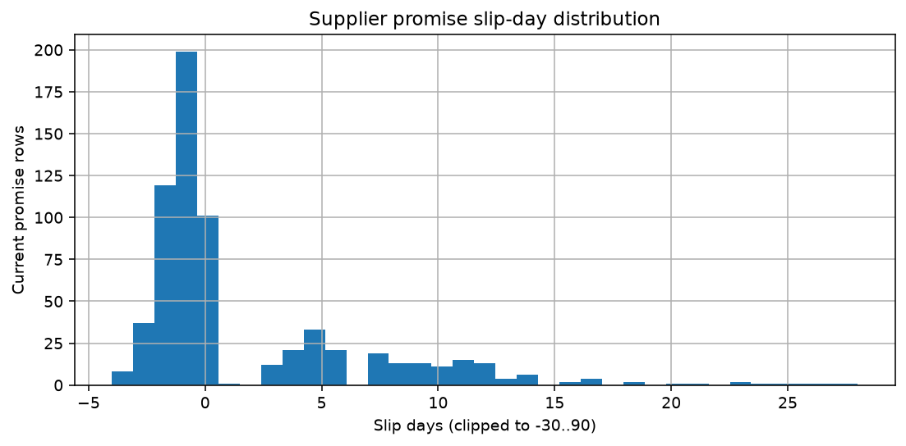
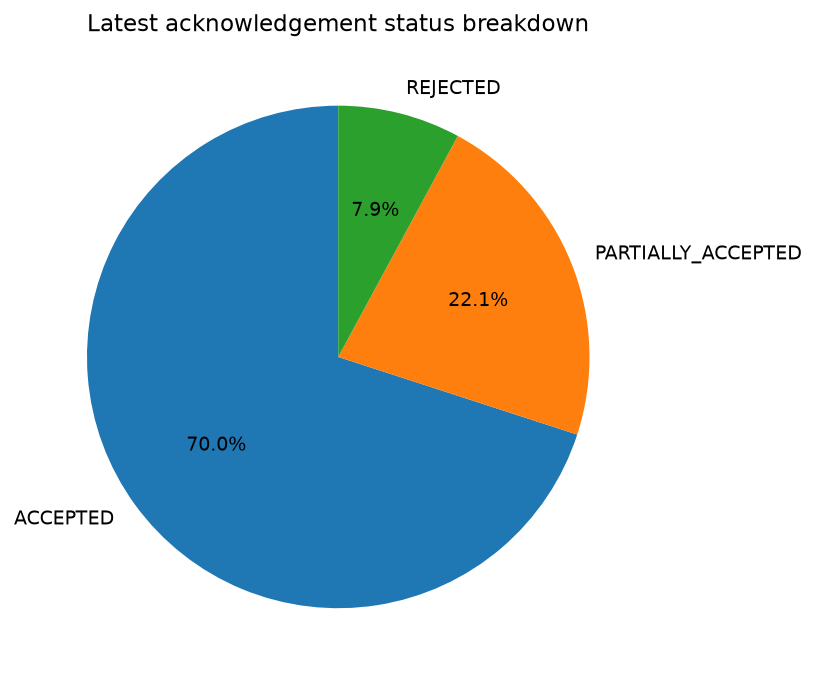
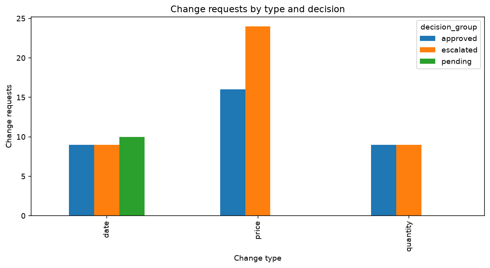
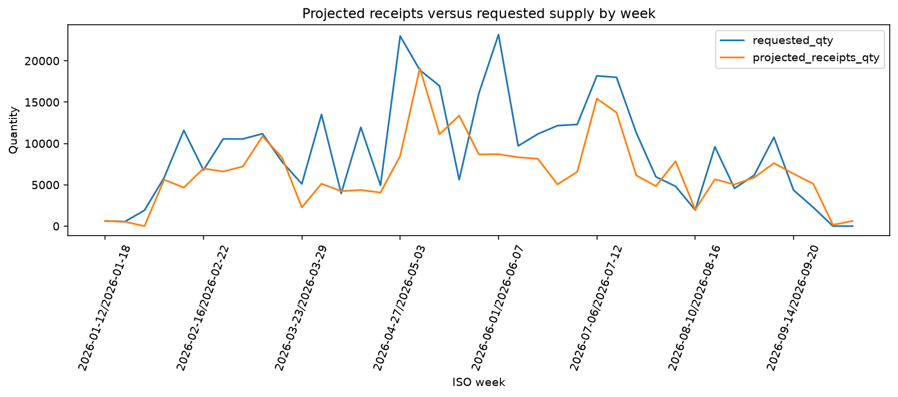
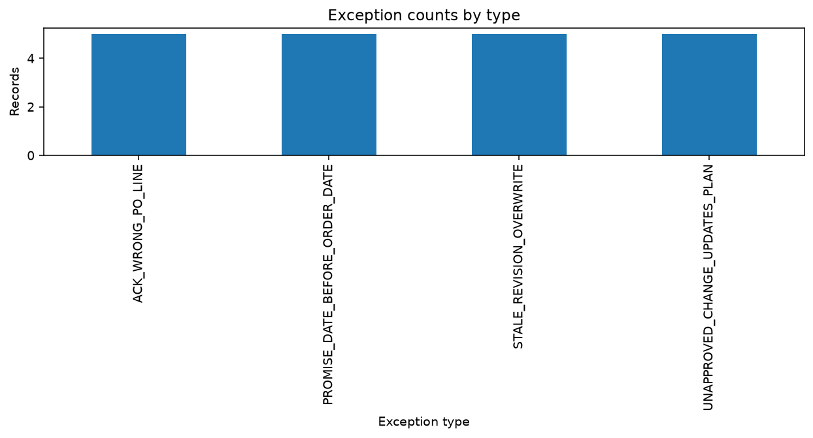

# Supplier acknowledgement workflow — Operations Manager summary

## Headline KPIs

- Purchase orders: **200**
- Acknowledgement coverage: **95.00%** (190 of 200 POs)
- On-time promise rate: **69.98%**
- Average / median promise slip: **1.67 / -1.00 days**
- Partial acceptance rate: **22.11%**
- Supplier silence rate: **5.00%**
- PO revision rate: **8.00%**
- Production orders at risk: **5**; rescheduled: **10**
- Total computed positive delay days: **318**; allocated shortfall quantity: **308.29**
- Known labelled exceptions: **20** (open in labelled ground-truth view: 20)

## Supplier alerts (portfolio-relative)

Portfolio supplier on-time mean = 71.71%, population standard deviation = 29.94 percentage points; alert cutoff = mean − 2σ = 11.84%.
- **Atlas Packaging Solutions** on-time rate (0.00%) is at least 2σ below the portfolio — flagged for planner review.
- **Summit Metal Works** on-time rate (0.00%) is at least 2σ below the portfolio — flagged for planner review.

### Approval turnaround by approver level

| approval_level     |   decisions |   mean_turnaround_hours |   median_turnaround_hours |
|:-------------------|------------:|------------------------:|--------------------------:|
| operations_manager |          42 |                      30 |                        30 |
| planner            |          76 |                      12 |                        12 |

### Schedule and supply

- Severity distribution: `{"HIGH": 1, "LOW": 6, "MEDIUM": 8}`
- Plan version churn: {"lines": 791, "max_versions_per_line": 2, "mean_versions_per_line": 1.4083, "total_versions": 1114}
- Median acknowledgement-to-plan-update time: 0.0 hours
- Notification volume by type: `{"APPROVAL_DECISION": 118, "CHANGE_RAISED": 86, "DOWNSTREAM_IMPACT": 15, "PLAN_UPDATED": 318, "SUPPLIER_SILENCE_CHASE": 10, "WEEKLY_SUMMARY": 2}`
- Notification volume by recipient role: `{"carrier_warehouse_operator": 10, "logistics_analyst": 318, "operations_manager": 2, "planner": 429, "supplier": 128}`

### Exception breakdown

- By type: `{"ACK_WRONG_PO_LINE": 5, "PROMISE_DATE_BEFORE_ORDER_DATE": 5, "STALE_REVISION_OVERWRITE": 5, "UNAPPROVED_CHANGE_UPDATES_PLAN": 5}`
- By severity: `{"CRITICAL": 5, "HIGH": 15}`
- Open / resolved: **20 / 0**

### Weekly requested supply vs projected receipts

| week                  |   requested_qty |   projected_receipts_qty |
|:----------------------|----------------:|-------------------------:|
| 2026-01-12/2026-01-18 |          623.83 |                  623.83  |
| 2026-01-19/2026-01-25 |          537.85 |                  537.85  |
| 2026-01-26/2026-02-01 |         1913.48 |                    0     |
| 2026-02-02/2026-02-08 |         5864.21 |                 5620.83  |
| 2026-02-09/2026-02-15 |        11586.5  |                 4662.14  |
| 2026-02-16/2026-02-22 |         6776.96 |                 6970.21  |
| 2026-02-23/2026-03-01 |        10548.5  |                 6610.1   |
| 2026-03-02/2026-03-08 |        10545.7  |                 7208.65  |
| 2026-03-09/2026-03-15 |        11185    |                10871.3   |
| 2026-03-16/2026-03-22 |         7774.24 |                 8277.92  |
| 2026-03-23/2026-03-29 |         5107.21 |                 2268.86  |
| 2026-03-30/2026-04-05 |        13509.5  |                 5127.76  |
| 2026-04-06/2026-04-12 |         3953.18 |                 4229.9   |
| 2026-04-13/2026-04-19 |        11948.3  |                 4366.92  |
| 2026-04-20/2026-04-26 |         4936.22 |                 4061.13  |
| 2026-04-27/2026-05-03 |        22995.8  |                 8494.55  |
| 2026-05-04/2026-05-10 |        18881.1  |                19104.7   |
| 2026-05-11/2026-05-17 |        16965.8  |                11115.9   |
| 2026-05-18/2026-05-24 |         5618.62 |                13369.8   |
| 2026-05-25/2026-05-31 |        16055.2  |                 8676.09  |
| 2026-06-01/2026-06-07 |        23175.7  |                 8701.16  |
| 2026-06-08/2026-06-14 |         9707.17 |                 8327.88  |
| 2026-06-15/2026-06-21 |        11147.8  |                 8150.03  |
| 2026-06-22/2026-06-28 |        12160.5  |                 5049.53  |
| 2026-06-29/2026-07-05 |        12300.1  |                 6562.64  |
| 2026-07-06/2026-07-12 |        18182.2  |                15425.9   |
| 2026-07-13/2026-07-19 |        17999.9  |                13739.9   |
| 2026-07-20/2026-07-26 |        11313.2  |                 6144.93  |
| 2026-07-27/2026-08-02 |         5963.34 |                 4834.28  |
| 2026-08-03/2026-08-09 |         4814.52 |                 7846.56  |
| 2026-08-10/2026-08-16 |         1943.19 |                 1989.99  |
| 2026-08-17/2026-08-23 |         9587.67 |                 5657.42  |
| 2026-08-24/2026-08-30 |         4563.35 |                 5043.82  |
| 2026-08-31/2026-09-06 |         6165.18 |                 5878.48  |
| 2026-09-07/2026-09-13 |        10753.4  |                 7624.64  |
| 2026-09-14/2026-09-20 |         4349.35 |                 6328.92  |
| 2026-09-21/2026-09-27 |         2271.24 |                 5124.52  |
| 2026-09-28/2026-10-04 |            0    |                  155.979 |
| 2026-10-05/2026-10-11 |            0    |                  622.488 |

## Figures

## Persona report links

- Logistics Analyst: [exception_report.md](exception_report.md) and [exception_report.csv](exception_report.csv)
- Planner: [supplier_scorecard.csv](supplier_scorecard.csv) and [decision_log.csv](decision_log.csv)
- Carrier/Warehouse Operator: [impact_report.csv](impact_report.csv)
- Operations Manager: this summary report.
