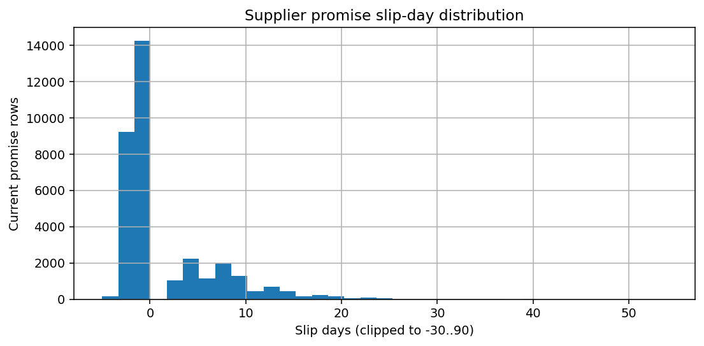
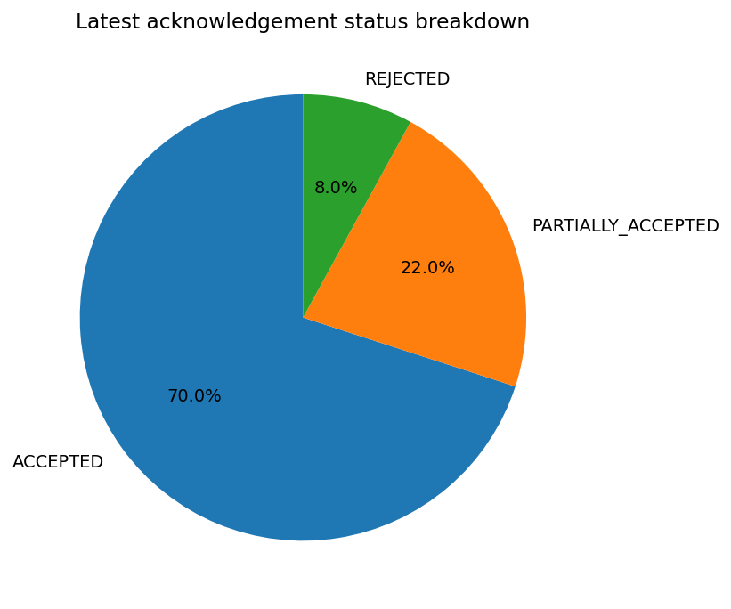
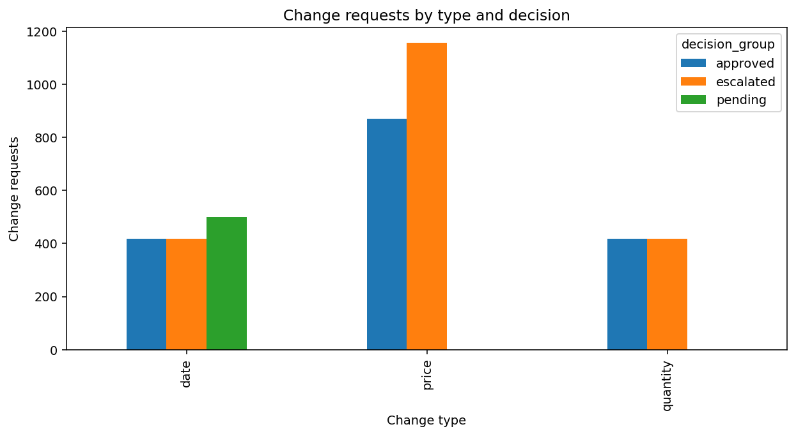
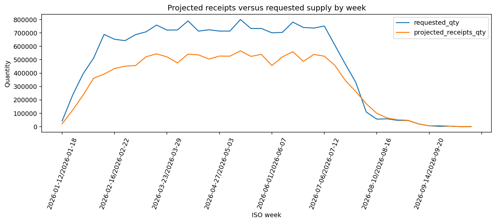
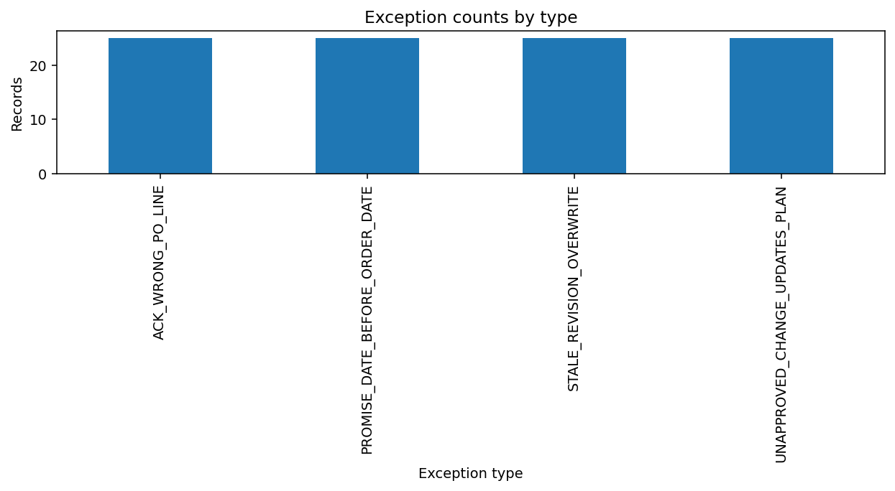

# Supplier acknowledgement workflow — Operations Manager summary

## Headline KPIs

- Purchase orders: **10,000**
- Acknowledgement coverage: **95.00%** (9,500 of 10,000 POs)
- On-time promise rate: **70.00%**
- Average / median promise slip: **1.61 / -1.00 days**
- Partial acceptance rate: **22.00%**
- Supplier silence rate: **5.00%**
- PO revision rate: **8.00%**
- Production orders at risk: **440**; rescheduled: **450**
- Total computed positive delay days: **16618**; allocated shortfall quantity: **27138.04**
- Known labelled exceptions: **100** (open in labelled ground-truth view: 100)

## Supplier alerts (portfolio-relative)

Portfolio supplier on-time mean = 73.82%, population standard deviation = 25.19 percentage points; alert cutoff = mean − 2σ = 23.44%.
- **Bluehaven Industrial Trading** on-time rate (0.00%) is at least 2σ below the portfolio — flagged for planner review.
- **Crestline Engineering Materials** on-time rate (0.00%) is at least 2σ below the portfolio — flagged for planner review.
- **Ironwood Metal Works** on-time rate (0.00%) is at least 2σ below the portfolio — flagged for planner review.
- **Keystone Industrial Supplies** on-time rate (0.00%) is at least 2σ below the portfolio — flagged for planner review.
- **Skyward Metal Works** on-time rate (0.00%) is at least 2σ below the portfolio — flagged for planner review.
- **Vantage Machine Components** on-time rate (0.00%) is at least 2σ below the portfolio — flagged for planner review.
- **Westbridge Motion Systems** on-time rate (0.00%) is at least 2σ below the portfolio — flagged for planner review.
- **Keystone Fluid Technologies** on-time rate (3.23%) is at least 2σ below the portfolio — flagged for planner review.
- **Meridian Manufacturing Supply** on-time rate (5.88%) is at least 2σ below the portfolio — flagged for planner review.
- **Cobalt Industrial Supplies** on-time rate (6.54%) is at least 2σ below the portfolio — flagged for planner review.
- **Westbridge Fastener Works** on-time rate (10.53%) is at least 2σ below the portfolio — flagged for planner review.
- **Vantage Packaging Solutions** on-time rate (14.29%) is at least 2σ below the portfolio — flagged for planner review.
- **Sterling Industrial Supplies** on-time rate (15.79%) is at least 2σ below the portfolio — flagged for planner review.
- **Primepath Fluid Technologies** on-time rate (18.18%) is at least 2σ below the portfolio — flagged for planner review.
- **Sterling Machine Components** on-time rate (23.33%) is at least 2σ below the portfolio — flagged for planner review.

### Approval turnaround by approver level

| approval_level     |   decisions |   mean_turnaround_hours |   median_turnaround_hours |
|:-------------------|------------:|------------------------:|--------------------------:|
| operations_manager |        1991 |                      30 |                        30 |
| planner            |        3697 |                      12 |                        12 |

### Schedule and supply

- Severity distribution: `{"CRITICAL": 90, "HIGH": 135, "LOW": 260, "MEDIUM": 456}`
- Plan version churn: {"lines": 39876, "max_versions_per_line": 2, "mean_versions_per_line": 1.4263, "total_versions": 56876}
- Median acknowledgement-to-plan-update time: 0.0 hours
- Notification volume by type: `{"APPROVAL_DECISION": 5688, "CHANGE_RAISED": 4197, "DOWNSTREAM_IMPACT": 941, "PLAN_UPDATED": 16975, "SUPPLIER_SILENCE_CHASE": 500, "WEEKLY_SUMMARY": 4}`
- Notification volume by recipient role: `{"carrier_warehouse_operator": 464, "logistics_analyst": 16975, "operations_manager": 4, "planner": 22613, "supplier": 6188}`

### Exception breakdown

- By type: `{"ACK_WRONG_PO_LINE": 25, "PROMISE_DATE_BEFORE_ORDER_DATE": 25, "STALE_REVISION_OVERWRITE": 25, "UNAPPROVED_CHANGE_UPDATES_PLAN": 25}`
- By severity: `{"CRITICAL": 25, "HIGH": 75}`
- Open / resolved: **100 / 0**

### Weekly requested supply vs projected receipts

| week                  |   requested_qty |   projected_receipts_qty |
|:----------------------|----------------:|-------------------------:|
| 2026-01-12/2026-01-18 |        42259.7  |                20948     |
| 2026-01-19/2026-01-25 |       235123    |               122978     |
| 2026-01-26/2026-02-01 |       395012    |               235233     |
| 2026-02-02/2026-02-08 |       511791    |               361660     |
| 2026-02-09/2026-02-15 |       689031    |               392417     |
| 2026-02-16/2026-02-22 |       652350    |               434070     |
| 2026-02-23/2026-03-01 |       642396    |               451799     |
| 2026-03-02/2026-03-08 |       687219    |               456077     |
| 2026-03-09/2026-03-15 |       708267    |               521904     |
| 2026-03-16/2026-03-22 |       758622    |               543635     |
| 2026-03-23/2026-03-29 |       721066    |               521186     |
| 2026-03-30/2026-04-05 |       722284    |               475962     |
| 2026-04-06/2026-04-12 |       789592    |               540911     |
| 2026-04-13/2026-04-19 |       713464    |               536303     |
| 2026-04-20/2026-04-26 |       723463    |               504739     |
| 2026-04-27/2026-05-03 |       713837    |               527076     |
| 2026-05-04/2026-05-10 |       713727    |               526403     |
| 2026-05-11/2026-05-17 |       799950    |               566207     |
| 2026-05-18/2026-05-24 |       733244    |               524629     |
| 2026-05-25/2026-05-31 |       733065    |               539716     |
| 2026-06-01/2026-06-07 |       700678    |               456125     |
| 2026-06-08/2026-06-14 |       704176    |               520798     |
| 2026-06-15/2026-06-21 |       780550    |               559910     |
| 2026-06-22/2026-06-28 |       740728    |               487165     |
| 2026-06-29/2026-07-05 |       736180    |               539662     |
| 2026-07-06/2026-07-12 |       751492    |               526105     |
| 2026-07-13/2026-07-19 |       609375    |               458536     |
| 2026-07-20/2026-07-26 |       467203    |               345222     |
| 2026-07-27/2026-08-02 |       330720    |               262272     |
| 2026-08-03/2026-08-09 |       109393    |               170925     |
| 2026-08-10/2026-08-16 |        56229.3  |                99691.8   |
| 2026-08-17/2026-08-23 |        58600.6  |                64225.4   |
| 2026-08-24/2026-08-30 |        46518.4  |                51474.7   |
| 2026-08-31/2026-09-06 |        46011.7  |                47352.6   |
| 2026-09-07/2026-09-13 |        20049.8  |                20401.2   |
| 2026-09-14/2026-09-20 |         6261.13 |                 6582.12  |
| 2026-09-21/2026-09-27 |         1949.47 |                 8309.93  |
| 2026-09-28/2026-10-04 |         3724.67 |                 3829.16  |
| 2026-10-05/2026-10-11 |            0    |                  822.484 |
| 2026-10-12/2026-10-18 |            0    |                  987.952 |

## Figures

## Persona report links

- Logistics Analyst: [exception_report.md](exception_report.md) and [exception_report.csv](exception_report.csv)
- Planner: [supplier_scorecard.csv](supplier_scorecard.csv) and [decision_log.csv](decision_log.csv)
- Carrier/Warehouse Operator: [impact_report.csv](impact_report.csv)
- Operations Manager: this summary report.
